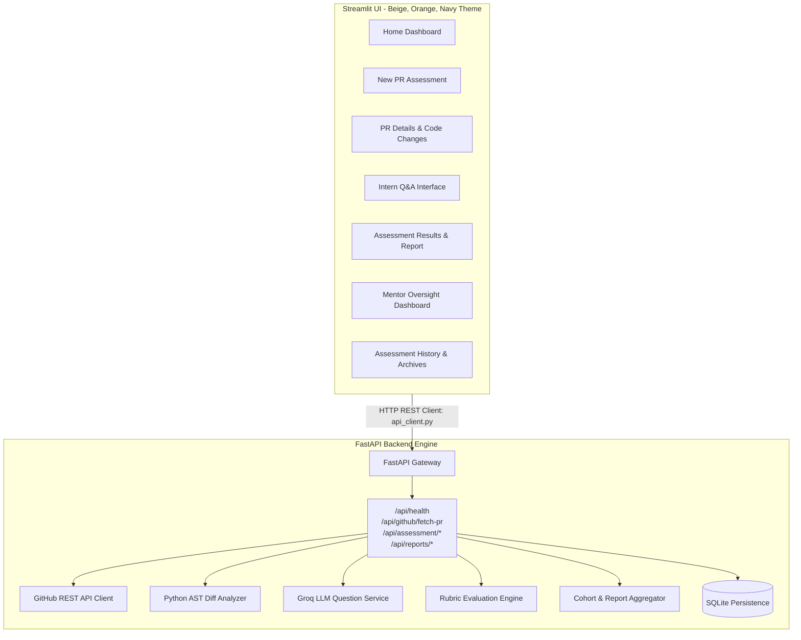

# PR Understanding Copilot

> Automated AI-driven technical interrogation and mentor evaluation platform for engineering interns.

PR Understanding Copilot connects to GitHub repositories, analyzes pull request code diffs using Python Abstract Syntax Trees (AST), extracts functions and edge-case patterns, and generates grounded technical interrogation questions via LLM. It guides interns through an evaluation workflow, grades answers using rubric scoring, detects misconceptions, and equips mentors with cohort performance analytics.

---

## Architecture Overview



---

## Key Features

- **AST-Based Code Diff Parsing**: Parses unified patches and builds an AST context of added/modified functions, classes, arguments, and edge-case keywords (`try`, `except`, `raise`).
- **Grounded Question Generation**: Leverages the Groq LLM to generate 5-8 targeted technical questions categorized by comprehension, architectural reasoning, and decision-making.
- **Interactive Evaluation Interface**: Provides interns with referenced code line numbers, progress indicators, draft auto-saving, and technical explanation areas.
- **Automated Rubric Evaluation**: Evaluates intern submissions against expected concepts, detects knowledge gaps, and penalizes misconceptions.
- **Mentor Diagnostic Insights**: Generates diagnostic reports with strength identification, gap analysis, and tailored mentor follow-up questions.
- **Cohort Oversight Dashboard**: Tracks total assessments, average scores, pass rates, intern filtering, and JSON cohort data export.
- **Modern SaaS UI**: Styled in a Warm Beige (`#F5F2EB`), Deep Navy Blue (`#0B192C`), and Rich Orange (`#EA580C`) design system with strictly zero emojis.

---

## Project Structure

```
kg_demo/
├── .streamlit/
│   └── config.toml                  # Streamlit light base theme configuration
├── backend/
│   ├── api/
│   │   ├── assessment.py            # Assessment lifecycle routes
│   │   ├── github.py                # GitHub fetch endpoint
│   │   ├── health.py                # Heartbeat endpoint
│   │   └── reports.py               # Report retrieval routes
│   ├── config/
│   │   └── settings.py              # Application settings & environment config
│   ├── core/
│   │   ├── diff_analyzer.py         # Python AST diff parsing engine
│   │   ├── github_client.py         # GitHub REST API client
│   │   └── llm_client.py            # Groq client wrapper
│   ├── db/
│   │   └── database.py              # SQLAlchemy SQLite models & session
│   ├── logger/
│   │   └── logger.py                # Loguru logging setup
│   ├── main.py                      # FastAPI application entry point
│   ├── schemas/                     # Pydantic data models
│   └── services/                    # Business logic & evaluation services
├── frontend/
│   ├── api_client.py                # Frontend HTTP client
│   ├── app.py                       # Streamlit application entry point
│   ├── styles.py                    # CSS theme (Beige, Orange, Navy)
│   └── views/
│       ├── history.py               # View 7: History & Archives
│       ├── home.py                  # View 1: Home Dashboard
│       ├── intern_qa.py             # View 4: Intern Q&A Interface
│       ├── mentor_dashboard.py      # View 6: Mentor Dashboard
│       ├── new_assessment.py        # View 2: New Assessment Setup
│       ├── pr_details.py            # View 3: PR Details & Changes
│       └── results.py               # View 5: Results & Mentor Report
├── tests/                           # Unit and integration test suite
├── .env.example                     # Sample environment variables
├── conftest.py                      # Pytest fixtures & path setup
├── FILE_MANIFEST.md                 # Detailed architecture manifest
├── pytest.ini                       # Pytest configuration
└── requirements.txt                 # Python dependencies
```

---

## Installation & Setup

### 1. Prerequisites
- Python 3.10 or higher
- Git

### 2. Clone Repository & Install Dependencies
```bash
git clone https://github.com/jahnavikdave1834/PR-Copilot.git
cd PR-Copilot
pip install -r requirements.txt
```

### 3. Environment Variables
Copy `.env.example` to `.env` and provide your API keys:
```bash
cp .env.example .env
```
Key configuration values in `.env`:
- `GROQ_API_KEY`: Your Groq API key for question generation and rubric evaluation.
- `GITHUB_TOKEN`: (Optional) GitHub personal access token for higher rate limits.
- `DATABASE_URL`: `sqlite:///./pr_copilot.db`

---

## Running the Application

### Start the FastAPI Backend
```bash
uvicorn backend.main:app --reload --port 8000
```
API Documentation will be available at `http://127.0.0.1:8000/docs`.

### Start the Streamlit Frontend
```bash
streamlit run frontend/app.py --server.port 8501
```
Open `http://localhost:8501` in your browser.

---

## Running the Test Suite

The test suite covers diff analysis, GitHub client integration, question generation schemas, rubric scoring, database persistence, and frontend API endpoints.

```bash
pytest tests
```
