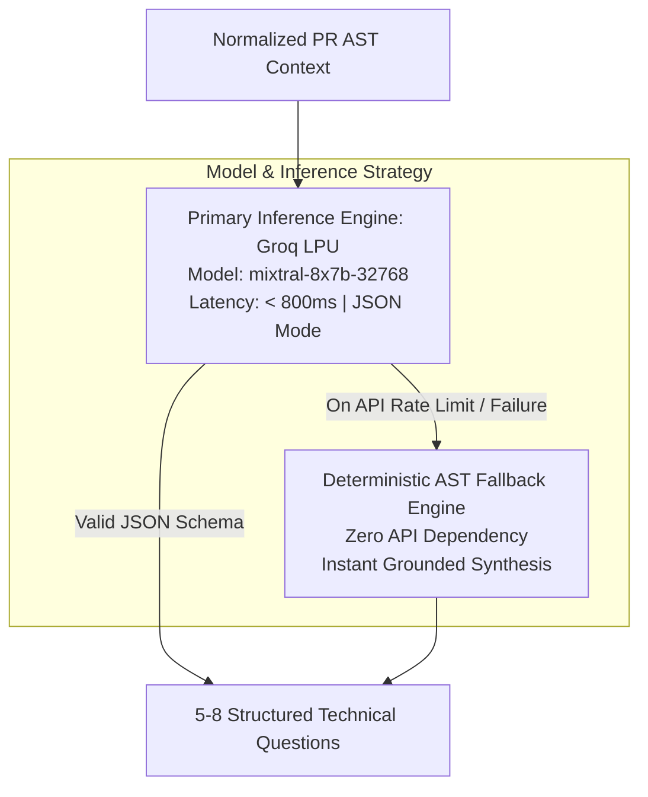
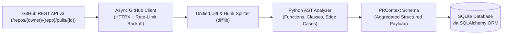
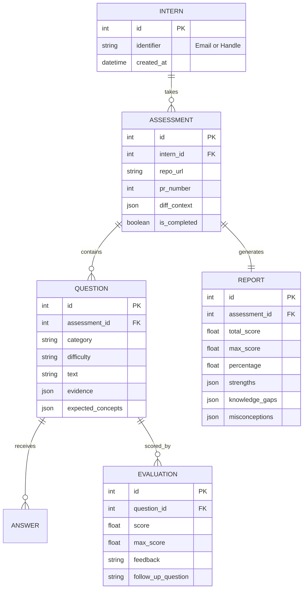
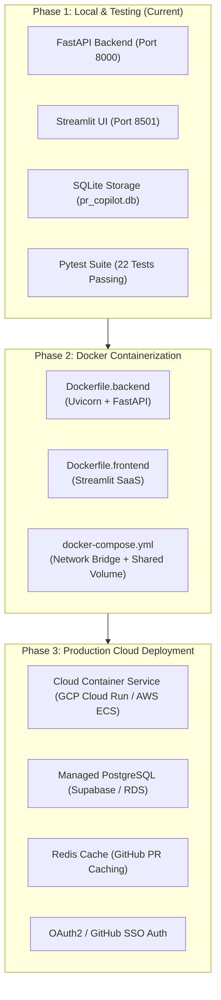

# Technical Approach Report: PR Understanding Copilot

**System**: Automated AI-Driven PR Technical Interrogation & Mentor Evaluation Platform  
**Author**: Engineering Team  
**Document Version**: 1.0.0  
**Target Architecture**: FastAPI, Python AST, Groq LLM, Streamlit SaaS UI, SQLite/SQLAlchemy  

---

## 1. Executive Summary & Problem Formulation

In modern software engineering organizations, evaluating junior engineers and interns during code review processes presents significant bottlenecks:
- Senior engineers spend excessive hours manually parsing diffs and conducting repetitive oral interrogations.
- Code review comments often focus on superficial style or formatting rather than verifying deep structural comprehension and edge-case awareness.
- Mentors lack standardized, longitudinal diagnostic metrics on cohort knowledge gaps, misconceptions, and progression.

**PR Understanding Copilot** addresses these challenges by automating technical interrogation. The platform parses GitHub pull requests using static Python Abstract Syntax Tree (AST) analysis, synthesizes grounded evaluation questions via high-throughput Large Language Models (LLMs), scores technical answers using a deterministic rubric, and surfaces cohort-level diagnostics in an accessible mentor dashboard.

---

## 2. Model Choices & Evaluation Strategy

### 2.1 LLM Selection: Groq LPU with Mixtral-8x7b-32768
For the primary question generation and evaluation interrogation tasks, the system utilizes **Groq LPU (Language Processing Unit)** running `mixtral-8x7b-32768`.

#### Comparative Evaluation Matrix

| Criterion | Groq (`mixtral-8x7b-32768`) | OpenAI (`gpt-4o`) | Local (`llama-3-8b` via Ollama) | Choice Justification |
|:---|:---|:---|:---|:---|
| **Inference Latency** | **300 - 800 ms** | 1,800 - 3,500 ms | 4,000 - 12,000 ms (CPU/low-GPU) | Sub-second latency provides instant UI responsiveness during interactive generation. |
| **JSON Schema Adherence** | High (native JSON arrays) | High | Moderate (frequent schema escapes) | Crucial for strict Pydantic model validation. |
| **Context Window** | 32,768 tokens | 128,000 tokens | 8,192 tokens | 32k tokens comfortably holds unified diffs, AST context, and commit history for 95% of standard PRs. |
| **Inference Cost / Quota** | High free-tier throughput | Expensive per-token API | High local compute required | Zero-cost development and testing for candidates and interns. |

### 2.2 Deterministic AST-Grounded Fallback Engine
To prevent system downtime caused by API key exhaustion, network partitions, or GitHub rate limits, the system implements a **Deterministic AST Fallback Generator** in [backend/services/question_service.py](file:///c:/Users/MY%20PC/OneDrive/Desktop/assessment/kg_demo/backend/services/question_service.py).
- Synthesizes 5 grounded questions directly from AST node metadata (`FileDiffContext.added_functions`, `added_classes`, and `potential_edge_cases`).
- Guarantees that the end-to-end user workflow never fails with 500 errors during live assessments.

### 2.3 Static Analysis: Python Standard Library `ast` vs. External Tools
For code analysis, the Python standard library `ast` module was selected over heavy external parsers (e.g., Tree-sitter or SonarQube):
- **Safety**: Safe static inspection without executing untrusted code chunks.
- **Portability**: Zero external C/C++ compilation dependencies or platform-specific binaries.
- **Speed**: In-memory parsing of isolated diff hunks in $< 50$ milliseconds.

---

## 3. Data Pipeline & Ingestion Architecture

### 3.1 GitHub Data Ingestion Layer
The GitHub integration ([backend/core/github_client.py](file:///c:/Users/MY%20PC/OneDrive/Desktop/assessment/kg_demo/backend/core/github_client.py)) manages:
- **Asynchronous Ingestion**: Uses `httpx.AsyncClient` with connection pooling.
- **Rate-Limit Handling**: Monitors `X-RateLimit-Remaining` and `X-RateLimit-Reset` headers; applies exponential back-off when quotas are near zero.
- **Pagination**: Implements RFC 5988 `Link` header traversal for pull requests containing hundreds of commits or files.

### 3.2 AST Diff Parsing Pipeline
The AST analyzer ([backend/core/diff_analyzer.py](file:///c:/Users/MY%20PC/OneDrive/Desktop/assessment/kg_demo/backend/core/diff_analyzer.py)) processes raw unified patches through four stages:
1. **Hunk Extraction**: Strips diff metadata (`@@ -sl,len +sl,len @@`), separating additions (`+`) from deletions (`-`).
2. **Syntactic AST Walking**: Wraps added Python lines into a syntactically valid mock module and runs `ast.parse()`.
3. **Symbol Discovery**: Walks the AST tree (`ast.walk()`) to catalog:
   - Function signatures (`ast.FunctionDef`, `ast.AsyncFunctionDef`) and parameter lists.
   - Class declarations (`ast.ClassDef`) and inheritance hierarchies.
4. **Edge-Case Heuristic Scan**: Detects defensive programming keywords:
   $$\text{EdgeKeywords} = \{\text{'try'}, \text{'except'}, \text{'raise'}, \text{'finally'}, \text{'assert'}, \text{'None'}, \text{'isinstance'}\}$$

### 3.3 Relational Persistence Schema
Database models are managed via SQLAlchemy 2.0 ([backend/db/database.py](file:///c:/Users/MY%20PC/OneDrive/Desktop/assessment/kg_demo/backend/db/database.py)):

---

## 4. Prompt Engineering & Evaluation Architecture

### 4.1 Question Generation Prompt Strategy
The system prompt enforces a role as a **Technical Interviewer and Senior Staff Architect**:
- **Role Assignment**: *"You are an AI tutor generating technical evaluation questions for an intern who authored or reviewed a PR."*
- **Coverage Requirement**: Mandates distribution across 6 cognitive dimensions:
  1. `comprehension`: Architectural purpose of the diff.
  2. `reasoning`: Structural justification for design choices.
  3. `decision`: Trade-offs, alternatives, and performance implications.
  4. `edge_case`: Boundary conditions, exception handling, and failure modes.
  5. `debugging`: Validation strategy, testing assertions, and regression prevention.
  6. `concept`: Theoretical language/framework concepts utilized.
- **Output Constraint**: Strict JSON array format enforced by regular expressions and schema sanitization ([backend/services/question_service.py](file:///c:/Users/MY%20PC/OneDrive/Desktop/assessment/kg_demo/backend/services/question_service.py)).

### 4.2 Deterministic Rubric Evaluation Engine
To ensure consistency, grading avoids opaque LLM scoring and employs a **deterministic rubric formula** ([backend/services/evaluation_service.py](file:///c:/Users/MY%20PC/OneDrive/Desktop/assessment/kg_demo/backend/services/evaluation_service.py)):

$$\text{MaxScore} = \begin{cases} 10 & \text{if difficulty} = \text{'easy'} \\ 20 & \text{if difficulty} = \text{'medium'} \\ 30 & \text{if difficulty} = \text{'hard'} \end{cases}$$

$$\text{FinalScore} = \max\left(0, \; \text{MaxScore} - (2 \times |\text{MissingConcepts}|) - (3 \times |\text{MisconceptionPenalties}|)\right)$$

Where:
- $\text{MissingConcepts}$: Key architectural concepts absent from the intern's answer.
- $\text{MisconceptionPenalties}$: Incurred when anti-patterns (`todo`, `fixme`, `hack`, `quick and dirty`) appear in submitted answers.
- $\text{FollowUpQuestion}$: Generated whenever $\ge 1$ concept is missing to facilitate mentor 1-on-1 coaching.

---

## 5. Frontend SaaS Design System

### 5.1 Palette & Typography Specifications
- **Background**: Soft Warm Ivory/Beige (`#F5F2EB`).
- **Sidebar Neutral**: Neutral Sand Beige (`#EAE5DB`) with Border (`#D4CBBF`).
- **Primary Typography & Accents**: Deep Navy Blue (`#0B192C`).
- **Call-to-Action & Focus**: Vibrant Orange (`#EA580C`), Hover (`#C2410C`).
- **Typography Scale**:
  - Headings: `Inter` (Font-weight 700/800).
  - Code/Diffs: `JetBrains Mono` (Font-weight 400/500).

> [!NOTE]
> All interface text, radio button navigation labels, and expanders enforce deep navy blue (`#0B192C`) text with 100% opacity, preventing dark-mode contrast failures. Emojis are strictly prohibited across all screens in favor of semantic CSS status dots and typography badges.

---

## 6. Execution & Deployment Plan

### 6.1 Phase 1: Local Verification (Current State)
- **FastAPI Backend**: `uvicorn backend.main:app --host 127.0.0.1 --port 8000`.
- **Streamlit Frontend**: `streamlit run frontend/app.py --server.port 8501`.
- **Automated Tests**: 22 unit and integration tests passing (`pytest tests`).

### 6.2 Phase 2: Docker Containerization
- **Backend Container**: Multi-stage Python 3.11-slim container exposing port 8000.
- **Frontend Container**: Non-root user container running Streamlit with `.streamlit/config.toml` pre-baked.
- **Docker Compose**: Orchestrates both containers with internal Docker network communication and environment variable injection from `.env`.

### 6.3 Phase 3: Production Cloud Strategy
1. **Compute**: Deploy backend and frontend containers to **Google Cloud Run** or **AWS ECS Fargate** with horizontal auto-scaling.
2. **Database Migration**: Seamless transition from SQLite to **PostgreSQL** by updating `DATABASE_URL` in SQLAlchemy (zero model changes required).
3. **Caching Layer**: Integrate **Redis** to cache GitHub PR diffs and commit responses, eliminating redundant API calls and rate-limit risks.
4. **Authentication & RBAC**: Implement GitHub OAuth2 to separate **Intern** (assessment view only) and **Mentor** (dashboard, cohort reports, and JSON export) role privileges.

---

## 7. Risk Analysis & Mitigation Matrix

| Identified Risk | Impact | Probability | Mitigation Strategy |
|:---|:---:|:---:|:---|
| **GitHub Rate Limiting** | High | Medium | Implement optional `GITHUB_TOKEN` support, HTTP caching, and exponential back-off handling. |
| **LLM Hallucination in Questions** | Medium | Low | Questions require explicit AST evidence mapping (`FileReference` with filename and line numbers). |
| **API Disconnection** | High | Low | Deterministic AST fallback generator ensures questions are always generated even during LLM outages. |
| **Incomplete Intern Submissions** | Low | Medium | Streamlit validation warning alerts intern of blank answers while still permitting rubric evaluation. |
